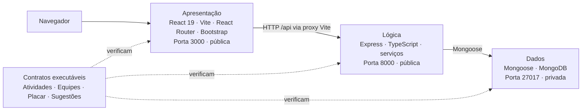

# Arquitetura do OctoFit Tracker

O OctoFit Tracker é uma aplicação de três camadas para um programa de atividades físicas escolar. O código inicial inclui contratos de API e pontos de implementação intencionalmente incompletos para que você use o modo agent do GitHub Copilot em um ciclo guiado por testes.

## Limites entre as camadas

- **Camada de apresentação**: React 19, Vite, React Router, Bootstrap e um cliente compartilhado da API em `octofit-tracker/frontend/src`.
- **Camada de lógica**: rotas e serviços Express com TypeScript em `octofit-tracker/backend/src` expõem o comportamento `/api/*` na porta `8000`.
- **Camada de dados**: modelos Mongoose e dados de demonstração em `octofit-tracker/backend/src/models` e `src/scripts/seed.ts` são persistidos no MongoDB na porta `27017`.

## Portas e regras de ambiente

- MongoDB: `27017` (privada)
- API Express: `8000` (pública)
- Interface Vite: `3000` (pública)
- O navegador acessa caminhos relativos `/api`. O Vite os encaminha para `http://localhost:8000`; `VITE_API_BASE_URL` pode substituir a URL-base.
- Não encaminhe nem torne públicas outras portas.

## Contrato da API

| Capacidade | Método e caminho | Comportamento esperado |
| --- | --- | --- |
| Registro de atividades | `GET /api/activities`, `POST /api/activities` | Lista atividades em `activities` e retorna a atividade criada em `activity` com status 201. O POST recebe `userId`, `teamId`, `type` e `minutes`; campos inválidos retornam 400, e referências bem-formadas a uma pessoa ou equipe inexistente retornam 404. A atividade armazena `user`, `team`, `type` e `minutes`, com um ponto por minuto e `occurredAt` definido no momento do registro. |
| Equipes | `GET /api/teams`, `POST /api/teams` | Lista equipes e seus IDs de integrantes. Cria equipes com `201`, preservando `name`, `mascot` e `members` (vazio se omitido). Dados inválidos retornam `400`; integrantes inexistentes retornam `404`. |
| Placar | `GET /api/leaderboard` | Ordena as equipes com atividades pela soma dos pontos, da maior para a menor. Em caso de empate, ordena pelo nome e depois pelo ID. Cada item contém `teamName`, `totalPoints` e `rank`, com posições sequenciais a partir de 1. |
| Sugestões de treino | `GET /api/workouts/suggestions/:userEmail` | Prioriza treinos compatíveis com a atividade mais recente cujo tipo tem um foco conhecido. Também inclui treinos compatíveis com a meta da pessoa. Cada sugestão explica o motivo em `reason`. Um e-mail sem pessoa correspondente retorna `404`. |

## Decisões de implementação

Plano para implementar os contratos existentes com mudanças pequenas e guiadas por testes, sem introduzir autenticação.

- Decisão da camada de apresentação: manter React, React Router e Bootstrap; conectar as quatro telas ao cliente compartilhado `src/api/client.ts`, usando `/api` e a configuração existente de URL-base. Apresentar conteúdo em português do Brasil, carregamento com `role="status"`, estado vazio específico e falhas com `role="alert"`. Não acessar o banco nem calcular pontuação ou recomendações na interface.
- Decisão da camada de lógica: manter as rotas responsáveis pelo contrato HTTP e concentrar nos serviços a validação de entradas e referências, os cálculos e as consultas aos modelos. Retornar `201` nas criações válidas, `400` nas entradas inválidas e um `4xx` intencional para referências ou pessoas inexistentes, sem deixar erros de conversão virarem `500`.
- Decisão da camada de dados: completar as validações obrigatórias dos modelos Mongoose de pessoas, equipes, atividades e treinos; preservar referências e a lista de integrantes com padrão `[]`, permitindo equipes vazias. Manter o seed idempotente por meio dos modelos, sem apagar dados não relacionados nem criar scripts diretos do MongoDB.
- Abordagem para registro de atividades: validar `userId`, `teamId`, `type` e `minutes`, verificar o formato dos IDs antes das consultas e confirmar a existência da pessoa e da equipe. Persistir `user`, `team`, `type` e `minutes` enviados, calcular pontos positivos e registrar `occurredAt` no serviço. Criar e listar atividades com esses campos preservados.
- Abordagem para gerenciamento de equipes: exigir nome e mascote, aceitar a lista de IDs de integrantes e preservar `name`, `mascot` e `members` na criação e na listagem. Rejeitar equipe sem nome com `400`.
- Abordagem para o placar: agregar os pontos das atividades persistidas por equipe, associar o nome da equipe e ordenar os totais do maior para o menor. Retornar `teamName`, `totalPoints` e `rank` sequencial iniciada em 1.
- Abordagem para sugestões de treino: localizar a pessoa pelo e-mail recebido, consultar sua meta e suas atividades recentes e priorizar treinos com foco compatível. Incluir `reason` em português explicando a recomendação e retornar `404` quando a pessoa não existir, em vez de selecionar sempre o primeiro treino.

### Ordem mínima segura

1. Completar as validações dos modelos e confirmar que o seed continua idempotente.
2. Implementar criação e listagem de equipes com integrantes.
3. Implementar validação, criação e listagem de atividades com pontos e data calculados.
4. Implementar o placar a partir dos pontos persistidos e as sugestões personalizadas.
5. Conectar uma tela por vez à API, cobrindo conteúdo, carregamento, vazio e erro.
6. Executar novamente todas as suítes e as duas compilações para validar a integração.

## Plano de testes

Executar os comandos a partir da raiz do repositório, sem mudar de diretório. Validar cada capacidade após sua implementação antes de avançar.

### Linha de base observada

Os resultados abaixo vêm dos logs fornecidos, não de uma nova execução durante esta atualização do documento. O comando original do backend não foi informado; o último comando informado do frontend foi `DEBUG_PRINT_LIMIT=1 npm -s test --prefix octofit-tracker/frontend`, com código de saída `1`.

| Suíte | Resultado informado | Significado das falhas |
| --- | --- | --- |
| Dados | 4 falhas e 1 aprovação | Faltam validações obrigatórias nos quatro modelos: identidade e meta da pessoa; nome e mascote da equipe; referências, tipo, minutos, pontos e data da atividade; foco, duração e dificuldade do treino. O teste de seed idempotente passa e deve continuar passando. |
| API | 4 falhas | Criação de atividades e equipes retorna `501` em vez de validar entradas com `400`; o placar retorna `[]`; sugestões não incluem `reason` e o serviço ignora o e-mail da pessoa. |
| Frontend | 15 falhas | Três testes de conteúdo e consulta por pessoa falham; outros doze verificam carregamento, vazio e erro nas quatro telas. As telas ainda exibem “Implementação pendente” e não consultam a API. |

Total informado: **23 testes falhando e 1 passando**. Cada teste interrompe na primeira asserção que falha; as verificações posteriores também precisam passar, incluindo IDs malformados ou inexistentes, persistência dos campos, personalização e pessoa desconhecida.

### Comandos e critérios de aceitação

| Etapa | Comando | Critério de aceitação |
| --- | --- | --- |
| Dados | `npm run test:data --prefix octofit-tracker/backend` | Os cinco testes passam: campos obrigatórios, referências e integrantes funcionam; o seed mantém vínculos, preserva dados não relacionados e não duplica registros. |
| API | `npm run test:api --prefix octofit-tracker/backend` | Os quatro testes passam: criação e listagem preservam campos; entradas e referências inválidas retornam `4xx`; placar soma e ordena corretamente; sugestões são personalizadas e justificadas, com `4xx` para pessoa desconhecida. |
| Frontend | `npm test --prefix octofit-tracker/frontend` | Os quinze testes passam: conteúdo da API é exibido, `run` aparece como “corrida”, sugestões usam o e-mail esperado e cada tela cobre carregamento acessível, vazio e alerta de erro. |
| Compilação do backend | `npm run build --prefix octofit-tracker/backend` | Compilação TypeScript concluída sem erros. Resultado ainda não verificado. |
| Compilação do frontend | `npm run build --prefix octofit-tracker/frontend` | Compilação e geração de produção concluídas sem erros. Resultado ainda não verificado. |

### Resultado da implementação da camada de lógica

Os quatro testes de contrato da API, a validação da etapa 3 e a compilação TypeScript do backend passaram. Os testes de contrato não foram alterados.

### Telas da camada de apresentação

As quatro telas usam o cliente compartilhado e exibem carregamento, lista vazia e alerta de erro em português do Brasil. Atividades mostra o tipo traduzido, a duração e os pontos; Equipes mostra nome, mascote e quantidade de integrantes; Placar mostra posição e pontuação na ordem da API; Sugestões de treino consulta a pessoa de demonstração `mona@example.com` e mostra o título e o motivo de cada recomendação.
